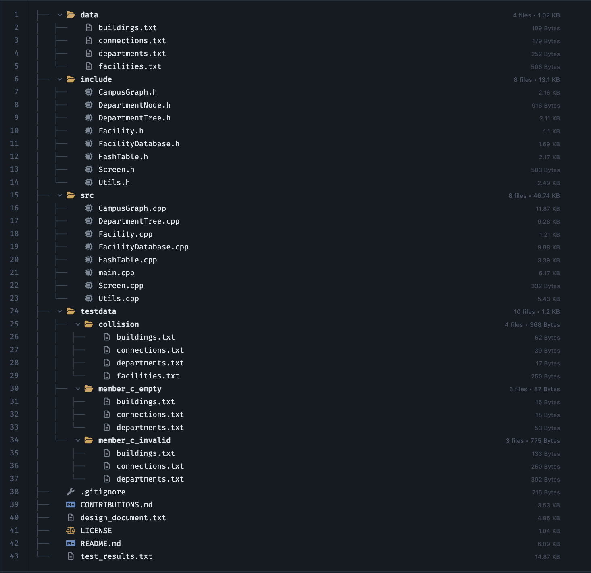

# Smart Campus Navigation and Facility Analytics System

**Course:** CSCE 2110 – Foundations of Data Structures  
**University:** University of North Texas  
**Project:** Project 2 – Milestone 1  
**Programming Language:** C++  
**Team Members:** Matthew Htang, Alka Gurung, Sankalp Gupta

## 1. Project Overview

The Smart Campus Navigation and Facility Analytics System is a C++ application that helps users explore campus facilities, buildings, connections, and academic departments.

This project demonstrates the use of important data structures, including a custom hash table, an adjacency-list graph, a queue for Breadth-First Search (BFS), and a general tree.

The program uses a menu-driven interface to allow users to search for facilities, view campus connections, identify reachable buildings, and explore department information.

## 2. Project Objectives

The main objectives of this project are:

Implement data structures using C++.

Manage campus facilities using a custom hash table.

Represent campus buildings and their connections using a graph.

Use BFS to find reachable buildings.

Organize academic departments using a general tree.

Read information from external text files.

Handle invalid inputs and duplicate records.

Practice teamwork, GitHub collaboration, testing, and documentation.

## 3. Main Features

Facility Management

Load facility records from text files.

Display campus facilities.

Search for facilities by ID.

Store facility information using a custom hash table.

Handle invalid and duplicate facility records.

### Campus Graph

Store buildings using an adjacency list.

Add connections between campus buildings.

Display buildings and their neighboring buildings.

Calculate the total number of buildings and connections.

Display the degree of each building.

Handle duplicate connections and isolated buildings.

### BFS Reachability

Find buildings reachable from a selected starting building.

Display buildings in BFS visiting order.

Calculate the distance from the starting building.

Count reachable buildings.

Handle invalid building names and disconnected graphs.

### Department Tree

Store academic departments using a general tree.

Add departments under existing departments.

Search for departments by name.

Display the department hierarchy.

Perform preorder traversal.

Handle duplicate departments and invalid parent references.

## 4. Data Structures Used

Data Structure

Purpose

Hash Table

Efficient facility searches using unique IDs

Graph (Adjacency List)

Stores campus buildings and connections

Queue

Performs BFS traversal

General Tree

Organizes academic departments

Vector

Stores dynamic collections of data

These data structures allow the program to manage campus information in an organized and efficient way.

## 5. Project Structure

The include folder contains header files, while the src folder contains C++ implementations. The data folder contains the input files, and testdata is used for additional testing.

## 6. Requirements

To compile and run the project, users need:

A C++17-compatible compiler, such as G++.

Optional: Visual Studio Code or another editor.

A terminal or command prompt.

Git, if cloning the repository.

Windows users can use MSYS2 UCRT64 with G++.

## 7. How to Compile and Run

Step 1: Clone the Repository

git clone https://github.com/MatthewHtang/campus-nav-analytics.git

Step 2: Open the Project Folder

cd campus-nav-analytics

Step 3: Compile the Program

From the project root, run:

g++ -std=c++17 -Iinclude src/*.cpp -o campus
Step 4: Run the Program

Using MSYS2:

./campus

Using Windows PowerShell:

.\campus

The program will display a menu where users can select different campus management features.

## 8. Input Files

The program uses external text files to load campus information.

File

Description

buildings.txt

Contains campus building names

connections.txt

Contains connections between buildings

facilities.txt

Contains facility information

departments.txt

Contains department hierarchy information

The program is designed to handle blank lines, comments, invalid records, and duplicate entries.

## 9. Testing

Testing is an important part of this project.

The team tests the following features:

Facility loading and searching.

Hash table operations.

Building and connection loading.

Graph display and statistics.

BFS reachability and distances.

Department addition and searching.

Department hierarchy and traversal.

Invalid inputs, duplicate records, and missing files.

Additional test cases are stored in the testdata folder.

Testing information and recorded results are documented in test_results.txt.

## 10. GitHub Repository

Repository: https://github.com/MatthewHtang/campus-nav-analytics

The team uses GitHub for version control, collaboration, code integration, and tracking project development.

University of North Texas
CSCE 2110 – Foundations of Data Structures
Smart Campus Navigation and Facility Analytics System
